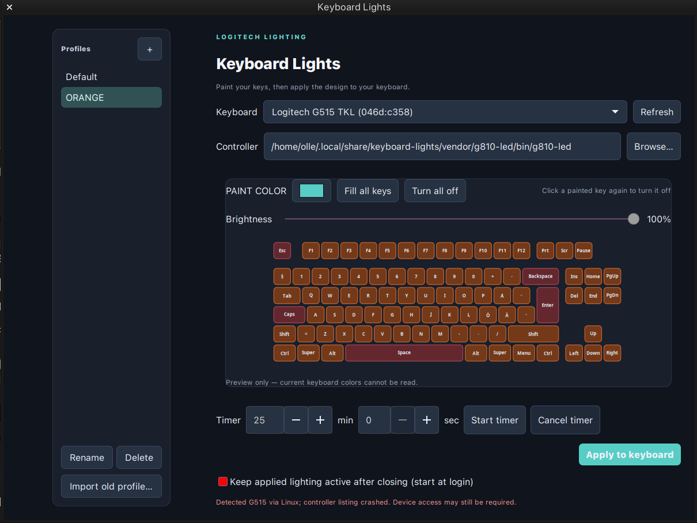

# Keyboard Lights

A Linux app made specifically for the **Logitech G515 TKL**. Paint and save per-key lighting profiles, adjust brightness, and use the top row as a countdown timer. The preview uses a Nordic ISO layout. Other keyboards may work, but are not the focus of this app.



## Install

On Ubuntu or Debian, install the dependencies, then clone and install the app:

```bash
sudo apt install git python3-gi python3-cairo python3-gi-cairo gir1.2-gtk-3.0 x11-utils make g++ libusb-1.0-0-dev
git clone https://github.com/visageeee/keyboard-lights.git
cd keyboard-lights
/usr/bin/python3 install.py
```

Open **Keyboard Lights** from your applications menu. The installer builds the bundled controller and installs the app for your user. To update it, pull the latest changes and run the installer again.

If applying a design reports **Permission denied**, install the included device rule and reconnect the keyboard:

```bash
sudo install -m 644 69-g515-led.rules /etc/udev/rules.d/
sudo udevadm control --reload-rules
```

## Use

Paint the keys and press **Apply to keyboard**. Enable **Keep applied lighting active after closing** to restore the design when the keyboard wakes and after login. This uses a background helper while you are logged in.

For a default that works without the app, **Save default color…** writes the selected paint color and brightness to the wired G515's onboard profile. This experimental option saves a solid color, not a per-key design. It backs up the existing profile under `~/.config/keyboard-lights/onboard-backups`, and verifies the write. Keep the keyboard connected and close other lighting apps while saving. You can turn off the backlight after a chosen idle delay. The background helper restores the last applied per-key design when you use the keyboard; it runs while you are logged in. The existing onboard sleep timeout is retained.

Enable **Show workspace on F1–F12** to mark the current X11 workspace with the chosen color. It requires background lighting and `xprop` (provided by `x11-utils` on Debian/Ubuntu). Workspaces above 12 have no corresponding key. The timer and idle-off mode take priority.

Set a timer in the app, or use these commands in a terminal or keyboard shortcut:

```bash
keyboard-lights-timer start 25m
keyboard-lights-timer status
keyboard-lights-timer cancel
```

The top row counts down in blue, then flashes red and plays a chime before restoring your design. The chime uses your desktop audio output and needs `paplay`, `pw-play`, `ogg123` or `ffplay`. Durations such as `90s` and `1h30m` are supported.

## License

GPL-3.0. Onboard profile support is adapted from [logirgb](https://github.com/mevdschee/logirgb), with its MIT license in [LICENSE-logirgb](LICENSE-logirgb). The bundled controller is based on [g810-led](https://github.com/MatMoul/g810-led); its attribution and [local modifications](vendor/g810-led/LOCAL-MODIFICATIONS.md) are included in the repository.
